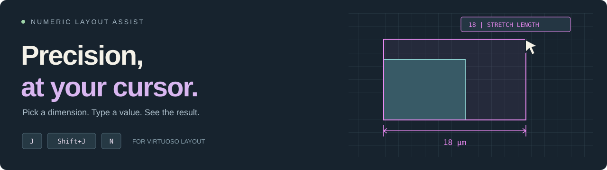
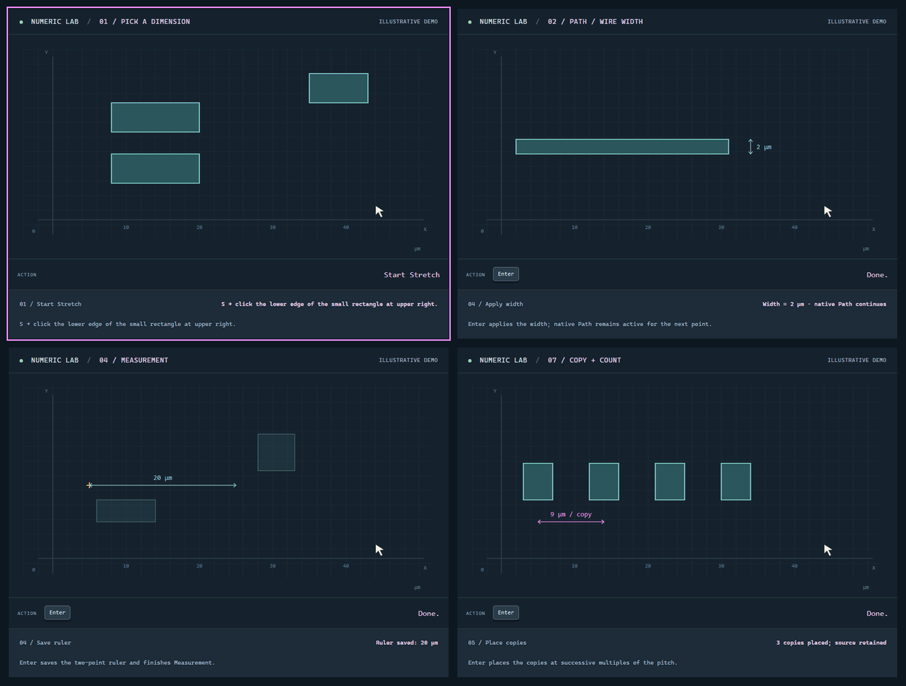

  

  
  
  

  <b><a href="docs/numeric_assist_guide.md">User guide</a></b> &nbsp;·&nbsp;
  <b><a href="docs/demo/index.html">Interactive lab</a></b> &nbsp;·&nbsp;
  <a href="docs/numeric_assist_guide.md#installation">Installation</a> &nbsp;·&nbsp;
  <a href="test/README.md">Testing</a>

Add precise numeric input to native **Virtuoso Layout** commands. Pick a length
or spacing from geometry, type a dimension, and preview the result at your
cursor. **J** handles numeric entry, **Shift+J** adds absolute positioning and
Contour, and **N** sets the Copy count.

## See it in motion

  

**Pick → Width → Measurement → Copy.** One panel plays at a time, with a
one-second pause between tools. These are illustrative animations using synthetic
geometry. [Open the interactive lab](docs/demo/index.html) to change values,
adjust playback speed, or step through every tool. The self-contained site runs locally by opening its
HTML file; [preview instructions](docs/numeric_assist_guide.md#interactive-demonstrations)
and [GitHub Pages deployment](docs/PUBLISHING.md) are documented separately.

## The tools

| Tool | What it helps you do | Watch / explore |
| --- | --- | --- |
| **Dimension picker** | Read an edge length, wire width, or parallel-edge spacing | [GIF](docs/media/pick.gif) · [Try it](docs/demo/index.html#pick) |
| **Path / Wire** | Set a width while drawing | [GIF](docs/media/width.gif) · [Try it](docs/demo/index.html#width) |
| **Rectangle** | Enter width and height together | [GIF](docs/media/rectangle.gif) · [Try it](docs/demo/index.html#rectangle) |
| **Measurement** | Give a new ruler a precise length | [GIF](docs/media/measure.gif) · [Try it](docs/demo/index.html#measure) |
| **Stretch** | Set a partial selection's final extent or move a whole selection | [GIF](docs/media/stretch.gif) · [Try it](docs/demo/index.html#stretch) |
| **Move** | Use a relative displacement or absolute position | [GIF](docs/media/move.gif) · [Try it](docs/demo/index.html#move) |
| **Copy + count** | Set the count and pitch, then preview every Step target | [GIF](docs/media/copy.gif) · [Try it](docs/demo/index.html#copy) |
| **Contour** | Resize a rectangle inside or outside a chosen pivot | [GIF](docs/media/contour.gif) · [Try it](docs/demo/index.html#contour) |
| **Steiner cleanup** | Remove invisible Steiner objects from the edited layout | [GIF](docs/media/cleanup.gif) · [Try it](docs/demo/index.html#cleanup) |

The ruler toolbar button toggles Numeric Assist. Full command behavior,
installation, grid handling, and key restoration are in the
**[user guide](docs/numeric_assist_guide.md)**.
