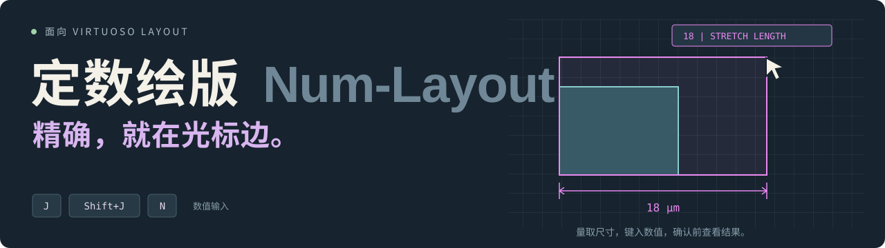
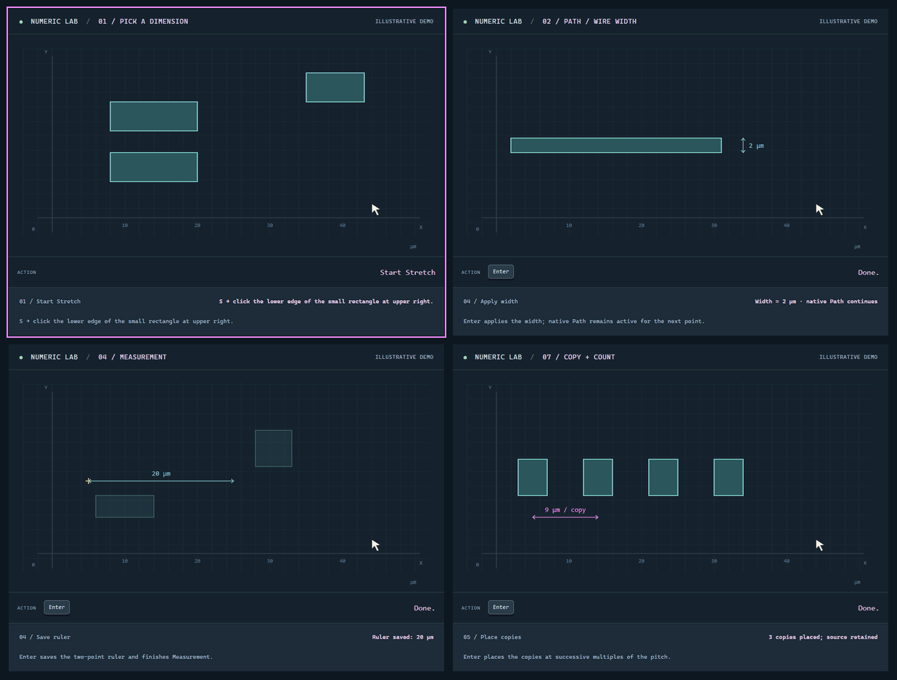

  

<h3 align="center">
  <a href="https://nekomona.github.io/Num-Layout/lab.html">▶ <strong>Try it out first!</strong> &nbsp;·&nbsp; <strong>直接看效果！</strong></a>
</h3>

  
  
  

  <a href="README.md">English</a> &nbsp;·&nbsp; <a href="README.zh-CN.md"><b>简体中文</b></a>

  <b><a href="docs/numeric_assist_guide.zh-CN.md">安装与使用指南</a></b> &nbsp;·&nbsp;
  <b><a href="docs/demo/index.html">交互演示</a></b> &nbsp;·&nbsp;
  <a href="docs/numeric_assist_guide.zh-CN.md#安装">安装</a> &nbsp;·&nbsp;
  <a href="test/README.md">测试</a> &nbsp;·&nbsp;
  <a href="CONTRIBUTING.zh-CN.md">参与贡献</a>

**定数绘版（Num-Layout）** 为 **Virtuoso Layout** 的常用命令补上精确数值输入。尺寸可以从版图上拾取，也可以直接键入；
提交之前，结果就显示在光标旁。**J** 用于数值输入，**Shift+J** 用于绝对定位和 Contour，
**N** 用于设置 Copy 数量。

## 看一段演示

  

**尺寸拾取 → Path 宽度 → Measurement → Copy。** 四个面板依次播放，切换时停顿一秒。
动画取自试验场，只用于说明操作。打开
[交互演示](docs/demo/index.html) 可以修改数值、调整速度，逐步查看全部工具。
站点可直接打开 HTML 文件运行；[本地预览说明](docs/numeric_assist_guide.zh-CN.md#交互演示)
和 [Pages 部署](docs/PUBLISHING.md) 见单独文档。

## 工具一览

| 工具 | 用途 | 演示 / 试用 |
| --- | --- | --- |
| **尺寸拾取** | 读取边长、Wire 宽度或平行边间距 | [GIF](docs/media/pick.gif) · [试用](docs/demo/index.html#pick) |
| **Path / Wire** | 绘制 Path 或 Wire 时设置宽度 | [GIF](docs/media/width.gif) · [试用](docs/demo/index.html#width) |
| **Rectangle** | 一次输入宽度和高度 | [GIF](docs/media/rectangle.gif) · [试用](docs/demo/index.html#rectangle) |
| **Measurement** | 给新标尺指定精确长度 | [GIF](docs/media/measure.gif) · [试用](docs/demo/index.html#measure) |
| **Stretch** | 设置局部选择的最终尺寸，或平移整个对象 | [GIF](docs/media/stretch.gif) · [试用](docs/demo/index.html#stretch) |
| **Move** | 按相对距离移动，或把参考点放到绝对坐标 | [GIF](docs/media/move.gif) · [试用](docs/demo/index.html#move) |
| **Copy + count** | 设置副本数量和间距，预览每个 Step 目标 | [GIF](docs/media/copy.gif) · [试用](docs/demo/index.html#copy) |
| **Contour** | 以指定 pivot 为基准，向内或向外调整矩形 | [GIF](docs/media/contour.gif) · [试用](docs/demo/index.html#contour) |
| **Steiner 清理** | 删除当前版图中的不可见 Steiner 对象 | [GIF](docs/media/cleanup.gif) · [试用](docs/demo/index.html#cleanup) |

工具栏的标尺按钮用来开关 Num-Layout。完整命令说明、安装方法、网格处理和键位恢复见
**[使用指南](docs/numeric_assist_guide.zh-CN.md)**。

## 致谢

开发与 Virtuoso 测试过程中使用了 [Virtuoso Bridge Lite](https://github.com/Arcadia-1/virtuoso-bridge-lite)，一个轻巧的 Virtuoso 桥接工具。
